<picture>
  <source media="(prefers-color-scheme: dark)" srcset="assets/header-dark.svg">
  
</picture>

  
  
  
  
  

<picture>
  <source media="(prefers-color-scheme: dark)" srcset="assets/stats-dark.svg">
  
</picture>

### Things I've built

  <a href="https://github.com/BeratARPA/HTML-Thermal-Printer"><picture><source media="(prefers-color-scheme: dark)" srcset="assets/card-printer-dark.svg">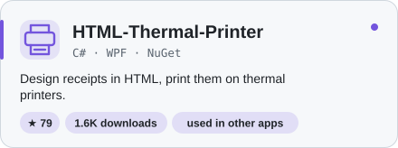</picture></a>
  <a href="https://github.com/BeratARPA/ARE"><picture><source media="(prefers-color-scheme: dark)" srcset="assets/card-are-dark.svg">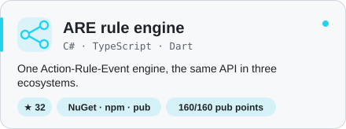</picture></a>

  <a href="https://play.google.com/store/apps/details?id=com.liwasoft.pentegrasyonkurye"><picture><source media="(prefers-color-scheme: dark)" srcset="assets/card-courier-dark.svg">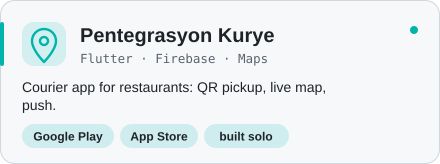</picture></a>
  <a href="https://github.com/BeratARPA/procurement-radar-kit"><picture><source media="(prefers-color-scheme: dark)" srcset="assets/card-radar-dark.svg">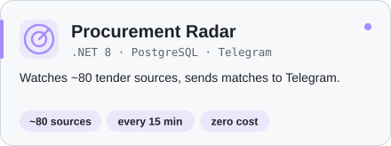</picture></a>

  <a href="https://github.com/BeratARPA/fuel_tr"><picture><source media="(prefers-color-scheme: dark)" srcset="assets/card-fuel-dark.svg">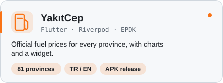</picture></a>
  <a href="https://github.com/BeratARPA/boiler_error_codes"><picture><source media="(prefers-color-scheme: dark)" srcset="assets/card-boiler-dark.svg">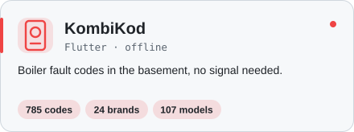</picture></a>

  <a href="https://github.com/BeratARPA/dilbaz"><picture><source media="(prefers-color-scheme: dark)" srcset="assets/card-lang-dark.svg">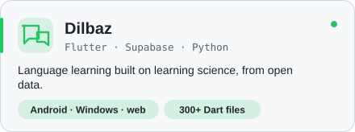</picture></a>
  <a href="https://github.com/BeratARPA/carkeep"><picture><source media="(prefers-color-scheme: dark)" srcset="assets/card-car-dark.svg">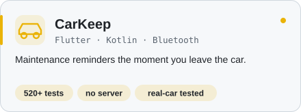</picture></a>

<picture>
  <source media="(prefers-color-scheme: dark)" srcset="assets/activity-dark.svg">
  
</picture>

<picture>
  <source media="(prefers-color-scheme: dark)" srcset="assets/toolbox-dark.svg">
  
</picture>

Every chart above is drawn from my own data by a GitHub Action in this repo, refreshed daily.

