
<b>English</b> · <a href="README.tr.md">Türkçe</a>

<a href="https://beratarpa.com/?lang=en"><picture><source media="(prefers-color-scheme: dark)" srcset="assets/hero-en-dark.svg"></picture></a>

<a href="https://github.com/BeratARPA/HTML-Thermal-Printer"><picture><source media="(prefers-color-scheme: dark)" srcset="assets/summary-en-dark.svg"></picture></a>

<a href="https://beratarpa.com/?lang=en"><picture><source media="(prefers-color-scheme: dark)" srcset="assets/services-en-dark.svg"></picture></a>

<picture><source media="(prefers-color-scheme: dark)" srcset="assets/work-en-dark.svg">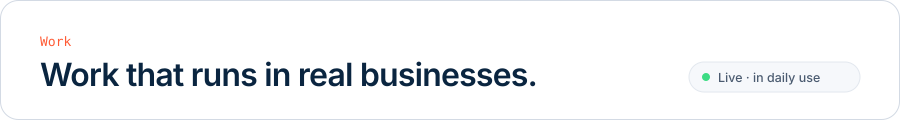</picture>

  <a href="https://www.tek-cozum.com/"><picture><source media="(prefers-color-scheme: dark)" srcset="assets/work-pos-en-dark.svg">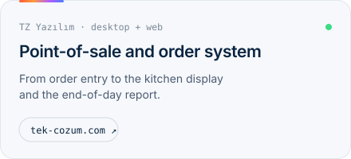</picture></a>
  <a href="https://beratarpa.com/#isler"><picture><source media="(prefers-color-scheme: dark)" srcset="assets/work-fiscal-en-dark.svg">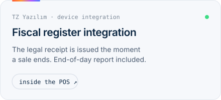</picture></a>

  <a href="https://www.sefimqr.com/"><picture><source media="(prefers-color-scheme: dark)" srcset="assets/work-qr-en-dark.svg">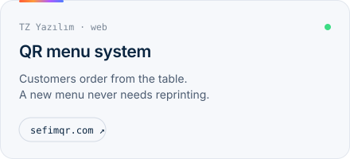</picture></a>
  <a href="https://pentegrasyon.net/"><picture><source media="(prefers-color-scheme: dark)" srcset="assets/work-orders-en-dark.svg">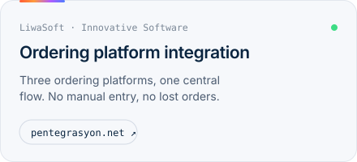</picture></a>

  <a href="https://play.google.com/store/apps/details?id=com.liwasoft.pentegrasyonkurye"><picture><source media="(prefers-color-scheme: dark)" srcset="assets/work-courier-en-dark.svg">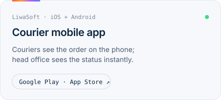</picture></a>
  <a href="https://easyhr.com.tr/"><picture><source media="(prefers-color-scheme: dark)" srcset="assets/work-hr-en-dark.svg">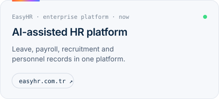</picture></a>

<a href="https://github.com/BeratARPA/ARE"><picture><source media="(prefers-color-scheme: dark)" srcset="assets/engine-en-dark.svg">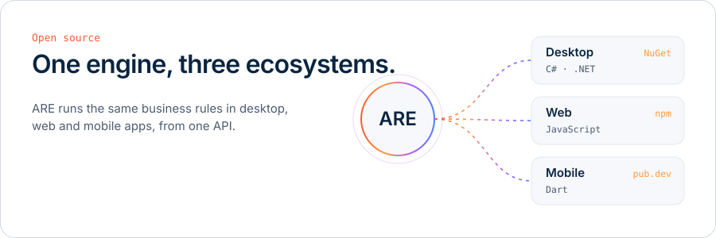</picture></a>

   

<a href="https://github.com/BeratARPA/HTML-Thermal-Printer"><picture><source media="(prefers-color-scheme: dark)" srcset="assets/printer-en-dark.svg">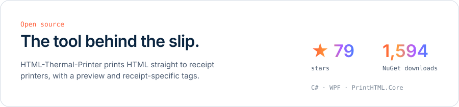</picture></a>

Side projects: <a href="https://github.com/BeratARPA/fuel_tr">YakıtCep</a> · <a href="https://github.com/BeratARPA/boiler_error_codes">KombiKod</a> · <a href="https://github.com/BeratARPA/procurement-radar-kit">Procurement Radar</a> · <a href="https://github.com/BeratARPA/carkeep">CarKeep</a> · <a href="https://github.com/BeratARPA/dilbaz">Dilbaz</a>

<a href="https://beratarpa.com/?lang=en"><picture><source media="(prefers-color-scheme: dark)" srcset="assets/cta-en-dark.svg"></picture></a>

<a href="https://beratarpa.com/?lang=en">beratarpa.com</a> · <a href="mailto:beratarpa@hotmail.com">beratarpa@hotmail.com</a> · <a href="https://www.linkedin.com/in/berat-arpa/">LinkedIn</a> · <a href="https://beratarpa.com/Resources/Berat_Arpa_FullStackDeveloper_EN_CV.pdf">CV</a>

